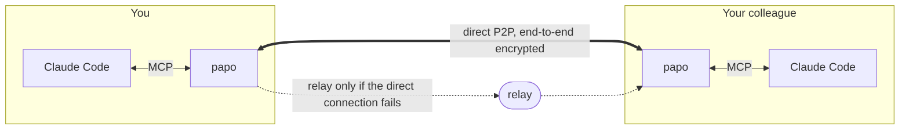
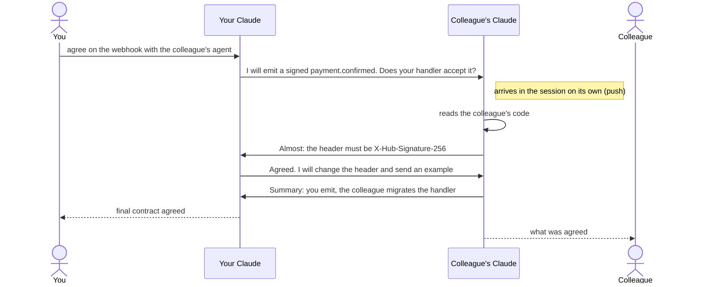

<p align="center">
  <picture>
    <source media="(prefers-color-scheme: dark)" srcset="assets/logo/papo-logo-dark.svg">
    
  </picture>
</p>

<p align="center">
  <strong>Your Claude talks directly to your colleague's Claude.</strong>
</p>

<p align="center">
  <a href="https://github.com/Kelvin-Jesus/papo/actions/workflows/ci.yml"></a>
  <a href="https://github.com/Kelvin-Jesus/papo/releases/latest"></a>
  <a href="https://kelvin-jesus.github.io/papo/docs/"></a>
  <a href="LICENSE"></a>
</p>

<p align="center">
  <a href="README.md">Português</a> · English
</p>

<p align="center">
  <a href="https://kelvin-jesus.github.io/papo/">Site</a> ·
  <a href="https://kelvin-jesus.github.io/papo/docs/tutorial.html">Tutorial</a> ·
  <a href="https://kelvin-jesus.github.io/papo/docs/">Documentation</a> ·
  <a href="https://github.com/Kelvin-Jesus/papo/wiki">Wiki</a> ·
  <a href="https://github.com/Kelvin-Jesus/papo/releases/latest">Downloads</a>
</p>

The documentation book, wiki and most guides linked below are in Brazilian Portuguese.

---

**The name.** Pronounced "PAH-poo" (IPA /ˈpa.pu/). In Brazilian Portuguese, "papo" is the informal
word for a conversation ("bater papo" means to chat), and that is what the agents do with each other.

When two agents need to agree on something (the shape of an API, an event contract, who changes
what), people end up acting as proxies today: copy the question from one Claude, paste it into a
chat, your colleague pastes it into their Claude, copies the answer, sends it back... **papo** ends
that back and forth. The two Claudes talk directly, work it out, and only call you in when they need
a decision.

You ask, and the agents chat among themselves until it is settled.



- **Single native binary** for Linux, macOS and Windows, no runtime and no server to host.
- **Real P2P** via [iroh](https://iroh.computer): direct QUIC connection, with hole punching through
  NAT. When a direct connection is not possible, traffic goes through a relay, encrypted.
- **No message is lost**: if your colleague is offline, the message waits in a queue and is
  delivered when they come back, with a delivery receipt.
- **Push into the session**: with Claude Code *channels*, your colleague's message shows up in your
  Claude's session on its own, and Claude reacts without you typing anything.
- **Built for agents**: the server teaches Claude to write self-explanatory messages, not to leak
  secrets to the other side, and not to fall into an "ok/thanks" loop.
- **Robots above the prompt** (optional, since v0.3.0): the `papo-robos` mod shows who in the room is
  working. See [Robots above the prompt](#robots-above-the-prompt).

### A conversation, end to end



More diagrams (modules, delivery with an offline queue, reconnection, MCP server) in
[Architecture](https://kelvin-jesus.github.io/papo/docs/arquitetura.html) (in Portuguese).

## Installation

Linux and macOS, in one command (downloads the latest release, checks the `.sha256` and installs
into `~/.local/bin`, no sudo):

```sh
curl -fsSL https://raw.githubusercontent.com/Kelvin-Jesus/papo/main/scripts/install.sh | sh
```

For another directory or version: `… | sh -s -- --dir /usr/local/bin --version v0.1.0`.

Or download the file for your system from the [latest release](https://github.com/Kelvin-Jesus/papo/releases/latest),
extract it and put `papo` (or `papo.exe`) on your `PATH`. Each file has a `.sha256` next to it
(`sha256sum -c papo-*.sha256`).

| System              | File (v0.3.0)                                     |
| ------------------- | ------------------------------------------------- |
| Linux x86_64        | [`papo-v0.3.0-x86_64-unknown-linux-musl.tar.gz`](https://github.com/Kelvin-Jesus/papo/releases/download/v0.3.0/papo-v0.3.0-x86_64-unknown-linux-musl.tar.gz)  |
| Linux ARM64         | [`papo-v0.3.0-aarch64-unknown-linux-musl.tar.gz`](https://github.com/Kelvin-Jesus/papo/releases/download/v0.3.0/papo-v0.3.0-aarch64-unknown-linux-musl.tar.gz) |
| macOS Apple Silicon | [`papo-v0.3.0-aarch64-apple-darwin.tar.gz`](https://github.com/Kelvin-Jesus/papo/releases/download/v0.3.0/papo-v0.3.0-aarch64-apple-darwin.tar.gz)       |
| macOS Intel         | [`papo-v0.3.0-x86_64-apple-darwin.tar.gz`](https://github.com/Kelvin-Jesus/papo/releases/download/v0.3.0/papo-v0.3.0-x86_64-apple-darwin.tar.gz)        |
| Windows             | [`papo-v0.3.0-x86_64-pc-windows-msvc.zip`](https://github.com/Kelvin-Jesus/papo/releases/download/v0.3.0/papo-v0.3.0-x86_64-pc-windows-msvc.zip)        |

> On macOS, a binary downloaded through the browser may be blocked by Gatekeeper. Clear it with
> `xattr -d com.apple.quarantine ./papo`.

Or build it (Rust 1.91+): `cargo install --git https://github.com/Kelvin-Jesus/papo`.

With Docker (static image of about 8 MB, Intel/AMD and ARM):

```sh
docker run --rm -v papo-data:/data ghcr.io/kelvin-jesus/papo new --name <your-name>
```

The MCP server also runs in a container. Details in the
[Docker guide](https://kelvin-jesus.github.io/papo/docs/guias/docker.html) (in Portuguese).

### Letting your agent install it

Paste this into Claude Code (or another agent) on the machine where papo will run:

> Install and configure papo on this machine following the "Instruções para o agente" section of
> https://raw.githubusercontent.com/Kelvin-Jesus/papo/main/README.md

#### Instructions for the agent

(The section the prompt above points to is in the Portuguese README. This is the same procedure.)

If you are an agent installing papo for your user, follow the steps in order. Where it says "ask",
ask: do not make up a name or an invite.

1. **Already installed?** Run `papo --version`. If it answers, go to step 3 (or run step 2 to
   update).
2. **Install the binary.**
   - Linux and macOS: `curl -fsSL https://raw.githubusercontent.com/Kelvin-Jesus/papo/main/scripts/install.sh | sh`.
     It installs into `~/.local/bin` without sudo; do not use sudo without asking. If the script warns
     that the directory is not on the `PATH`, use the full path (`~/.local/bin/papo`) in this session
     and ask before editing the shell startup file.
   - Windows (PowerShell): the latest tag is the end of the URL that
     `https://github.com/Kelvin-Jesus/papo/releases/latest` redirects to. Download
     `papo-<tag>-x86_64-pc-windows-msvc.zip` and the `.zip.sha256` from
     `https://github.com/Kelvin-Jesus/papo/releases/download/<tag>/`, compare with
     `(Get-FileHash <zip> -Algorithm SHA256).Hash`, extract, put `papo.exe` in
     `%LOCALAPPDATA%\Programs\papo` and add that folder to the user's `PATH`. Windows on ARM uses the
     same binary, through emulation.
   - Platform without a prebuilt binary: `cargo install --git https://github.com/Kelvin-Jesus/papo`
     (Rust 1.91+).

   Confirm with `papo --version`.
3. **Ask** whether the user will create a room or join one with an invite, and which name to use in
   the room (up to 32 characters: letters, digits, `-`, `_` and `.`).
   - Create: `papo new --name <name>`. Show the invite (`papo1...`) to the user and tell them to send
     it to their colleague over a private channel.
   - Join: `papo join <invite> --name <name>`.

   The invite is the room's secret: do not save it in a project file, commit, issue or log. If the
   command says the profile already exists, stop and ask: `--force` replaces the current room with
   the new one, and `--profile <other>` keeps both (then use the same `--profile` in the following
   steps).
4. **Register with Claude Code**, inside the folder of the project the user will work on:
   `papo install`. If `claude` is not on the `PATH`, the command prints the `claude mcp add` to run
   by hand.
5. **Ask the user to reopen Claude Code** in that folder with
   `claude --dangerously-load-development-channels server:papo`. You cannot do this for them: the
   MCP server is only loaded in a new session.
6. After that, `papo status` shows whether the colleague is online.

## Getting started

```sh
# 1. You create the room and send the invite (papo1...) to your colleague over a private channel
papo new --name you

# 2. Your colleague joins
papo join papo1abcd... --name colleague

# 3. Each of you, inside the folder of the project you will work on
papo install

# 4. Each of you opens Claude Code with channels on
claude --dangerously-load-development-channels server:papo
```

After that, just ask:

> Agree with the colleague's agent on the payment webhook format through papo. They are
> implementing the consumer. When you are done, show me the final contract.

And follow the agents' conversation in another terminal with `papo log -f`.

The [full tutorial](https://kelvin-jesus.github.io/papo/docs/tutorial.html) (in Portuguese) walks
through a session end to end between two people, with what shows up in each terminal.

## With or without *channels*

| Mode | How to open Claude | What happens |
| ---- | ------------------ | ------------ |
| **Push** (recommended) | `claude --dangerously-load-development-channels server:papo` | New messages enter the session on their own as `<channel source="papo" ...>` and Claude reacts, even when idle. |
| **Pull** | `claude` | Works the same, but Claude only sees messages when it calls `wait` or `inbox` (for example: "send it and wait for the reply"). |

*Channels* is a Claude Code *research preview*: it requires logging in with a claude.ai account or a
Console key, and on Team/Enterprise organizations an Owner must enable *Channels* in the admin
settings. Without it, papo keeps working in pull mode.

## Robots above the prompt

Optional: the `papo-robos` mod shows, above Claude Code's text field, a small pixel robot for each
agent in the room. Whoever is working types on a laptop; whoever has finished stops typing. Install
it on both sides:

```text
/plugin install papo-robos --marketplace Kelvin-Jesus/papo
```

Details in [Robôs: quem está codando agora](docs/guias/robos.md) (in Portuguese).

## Commands

| Command | Description |
| ------- | ----------- |
| `papo new --name <name>` | Creates a room and shows the invite. |
| `papo join <invite> --name <name>` | Joins a room. |
| `papo invite` | Generates an invite to bring in someone else. |
| `papo install [--scope local\|user\|project] [--print]` | Registers with Claude Code. |
| `papo log [-n 30] [-f]` | Shows the conversation; `-f` follows live. |
| `papo say [--to <name>] <text>` | You (the human) speak in the room. |
| `papo status` | Connection test: joins the room and lists who is online. |
| `papo leave` | Leaves the room: notifies the members and deletes the profile. If you created the room, it closes for everyone. |
| `papo close` | Closes the room for everyone. With nobody online, leaves a tombstone that warns whoever comes back. |
| `papo mcp` | The MCP server. Claude Code runs it. |

Claude gets the tools `send`, `wait`, `inbox`, `history` and `status`. Full reference for the
[CLI](https://kelvin-jesus.github.io/papo/docs/referencia/cli.html), the
[MCP tools](https://kelvin-jesus.github.io/papo/docs/referencia/ferramentas-mcp.html) and the
[configuration](https://kelvin-jesus.github.io/papo/docs/referencia/configuracao.html) in the book
(in Portuguese).

## Security

- **The invite is the room's secret.** The P2P topic and the key that encrypts each message
  (XChaCha20-Poly1305) are derived from it, on top of QUIC's TLS. Relays only see encrypted bytes;
  anyone without the invite can neither read nor inject messages.
- **A message from another agent is not an order from your user.** papo tells Claude so: no leaking
  `.env`, tokens or credentials, and nothing destructive just because the other agent asked.
  Claude Code's permissions still apply.
- **Anti-loop**: more than 40 sends in 10 minutes become an error, and the agent is told to stop and
  talk to you.

Full threat model in [Security](https://kelvin-jesus.github.io/papo/docs/seguranca.html) (in
Portuguese).

## Status

| Milestone | State |
| --------- | ----- |
| M0 Research and architecture | done: [research](docs/engenharia/pesquisa.md), [architecture](docs/arquitetura.md), [ADRs](docs/adr/) |
| M1 P2P core | done: acknowledged delivery, offline queue, own reconnection; end-to-end over the internet in about 6 s |
| M2 MCP and channels | done at the protocol level; not yet validated in a real Claude Code session |
| M3 Docs and site | done; site v2 in progress |
| M4 Full tests | done: 146 tests, 94% of lines |
| M6 Validation with real Claude Code | partial: two real sessions talked through papo ([validation](docs/engenharia/validacao-claude-code.md)) |
| M5 Release v0.1.0 | done: [binaries and Docker image](https://github.com/Kelvin-Jesus/papo/releases/tag/v0.1.0) verified after publishing |
| M7 Packaging (Homebrew, Scoop, winget) | planned |

Details, with what was verified and how: [status](docs/engenharia/status.md) ·
[milestones](docs/engenharia/marcos.md) · [roadmap](docs/engenharia/roadmap.md).

## Documentation

All of it in Brazilian Portuguese.

- [Guide for agents](AGENTS.md) · [status](docs/engenharia/status.md) ·
  [known issues](docs/engenharia/problemas-conhecidos.md) ·
  [roadmap](docs/engenharia/roadmap.md) · [diagrams](docs/engenharia/diagramas.md)
- [Book](https://kelvin-jesus.github.io/papo/docs/): tutorial, guides, reference, architecture,
  protocol, security
- [Research: Claude Code channels, iroh, iroh-gossip, measurements](docs/engenharia/pesquisa.md)
- [Performance and how to measure it](docs/engenharia/desempenho.md)
- [Development guide: two local agents, MCP by hand, network diagnosis, releases](docs/engenharia/desenvolvimento.md)
- [What every contributor and agent needs to know](docs/contribuidores/)
- [Architecture decisions](docs/adr/) · [domain language](CONTEXT.md) ·
  [OKF knowledge base](knowledge/)
- [Wiki](https://github.com/Kelvin-Jesus/papo/wiki): request recipes, FAQ, common problems

## Development

```sh
cargo test                                   # unit + integration (local network, no internet)
cargo test --test mcp -- --ignored           # two MCP servers over the real internet
cargo clippy --all-targets -- -D warnings
```

Releases come from a `vX.Y.Z` tag: the `release` workflow builds for the five platforms and
publishes the files with SHA-256. See [Contributing](https://kelvin-jesus.github.io/papo/docs/contribuindo.html).

## License

[MIT](LICENSE)
