# Robôs: quem está codando agora



O mod `papo-robos` desenha, acima do campo de texto do Claude Code, um robozinho em pixel para cada
agente da sala. Enquanto um agente trabalha, o robô dele digita num laptop e o código rola na tela.
Quando o turno termina, ele para de digitar, solta os braços e a tela mostra um visto verde. Membro
fora do ar aparece cinza, com a tela apagada.

Você vê o seu robô e o do seu colega, e o seu colega vê os dois do lado de lá.

## Instalar

Os dois lados precisam do mod e de um `papo` com suporte a ele (a versão que trouxe este guia ou
mais nova). No terminal do Claude Code:

```text
/plugin install papo-robos --marketplace Kelvin-Jesus/papo
```

Responda `y` para adicionar o marketplace e escolha o escopo de usuário. O mod passa a valer na
sessão em que foi instalado e em todas as próximas.

## Como funciona

O mod não fala com a rede. Ele troca dois arquivos com o `papo mcp` da mesma sessão, na pasta do
perfil:

- `working`: o mod grava `1` quando um turno começa e `0` quando termina. O servidor lê o arquivo a
  cada segundo e avisa a sala no `hello`, o mesmo frame de presença de sempre.
- `activity.json`: o servidor grava quem da sala está trabalhando. O mod lê o arquivo e redesenha os
  robôs.

O perfil é escolhido pelo diretório da sessão: o mod procura o `activity.json` cujo `cwd` é o
diretório em que o Claude Code está rodando. Com um único `papo mcp` vivo na máquina, usa esse.
Sem nenhum, a faixa fica vazia e o mod não aparece.

Os pixels usam o elemento `Raster` do terminal. No app de desktop aparecem só os nomes e o estado
de cada um ("codando…", "terminou ✓", "offline").

## Quando o robô não aparece

- A faixa só aparece com um `papo mcp` rodando para a sessão. `papo status` confirma.
- Um colega com `papo` antigo não envia o estado: o robô dele aparece sempre como "terminou".
- Se a sessão do colega cair no meio de um turno, o robô dele para de digitar em até 30 segundos.

Os detalhes dos arquivos estão em [Configuração e arquivos](../referencia/configuracao.md) e o
campo `working` do `hello` em [Protocolo](../referencia/protocolo.md).
